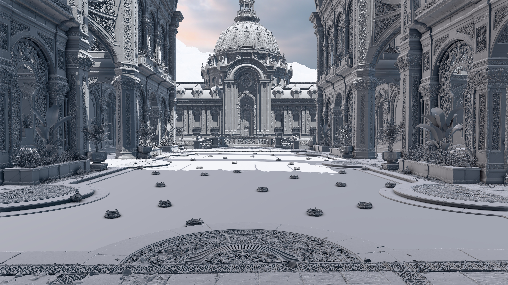
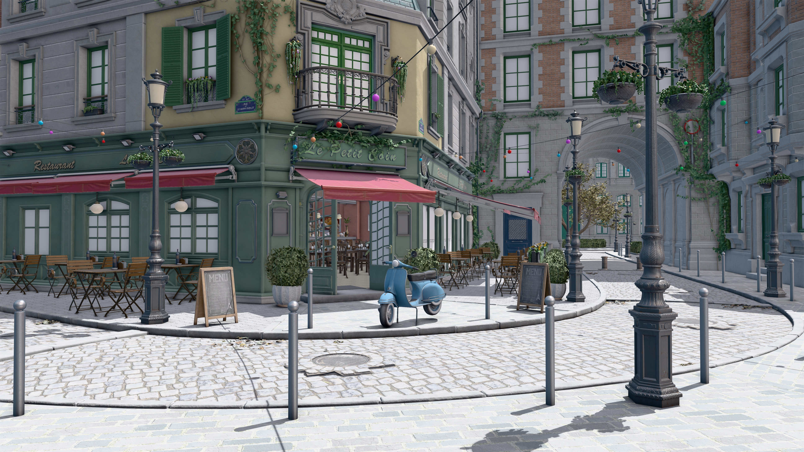
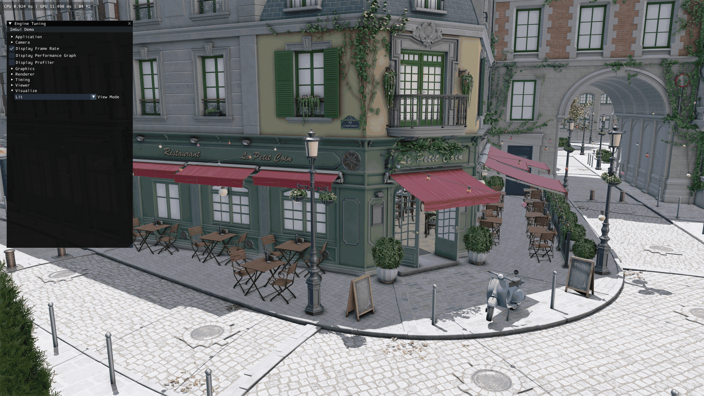
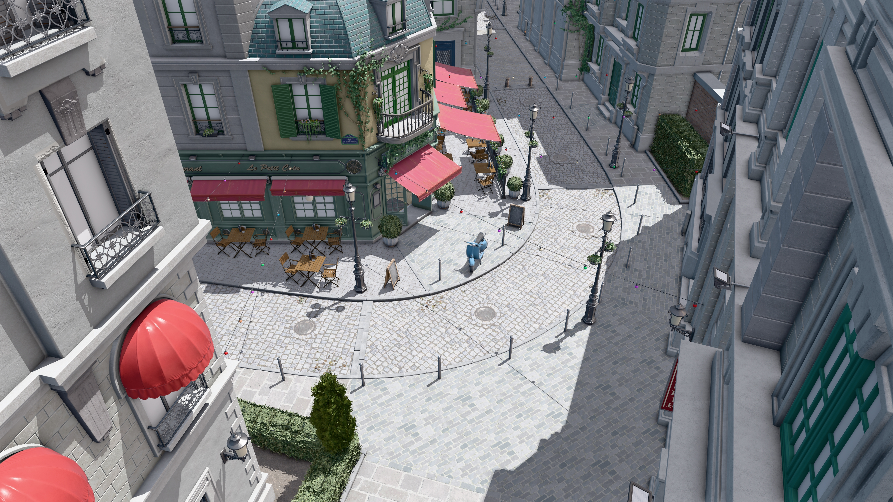
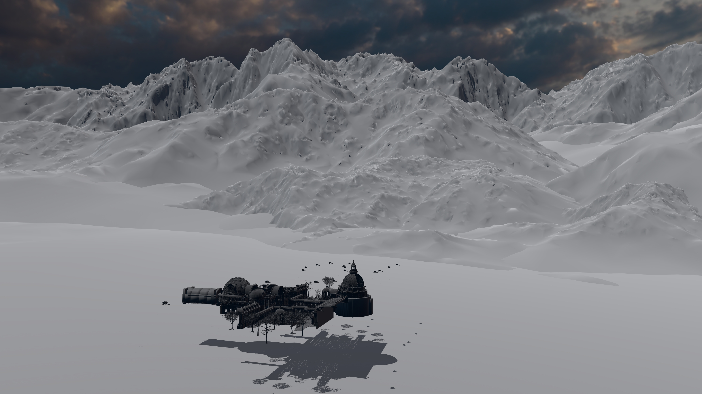
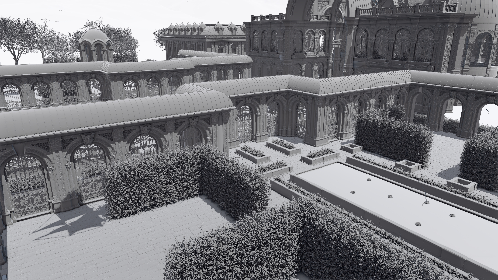
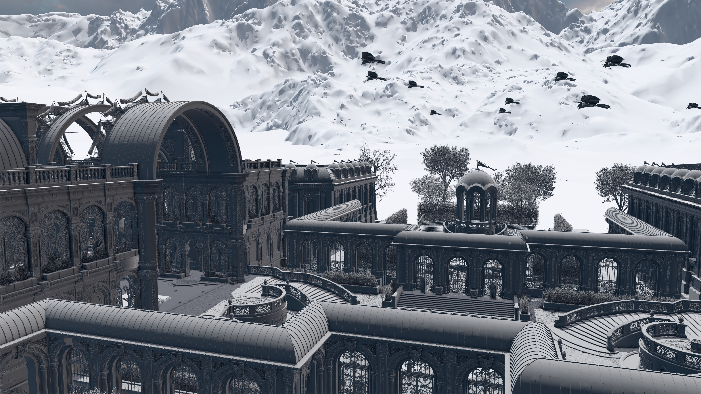
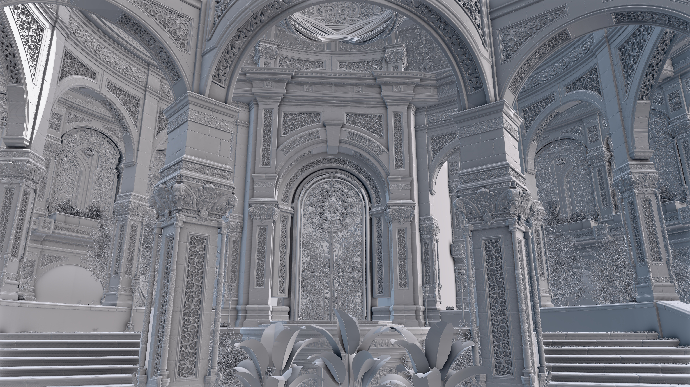
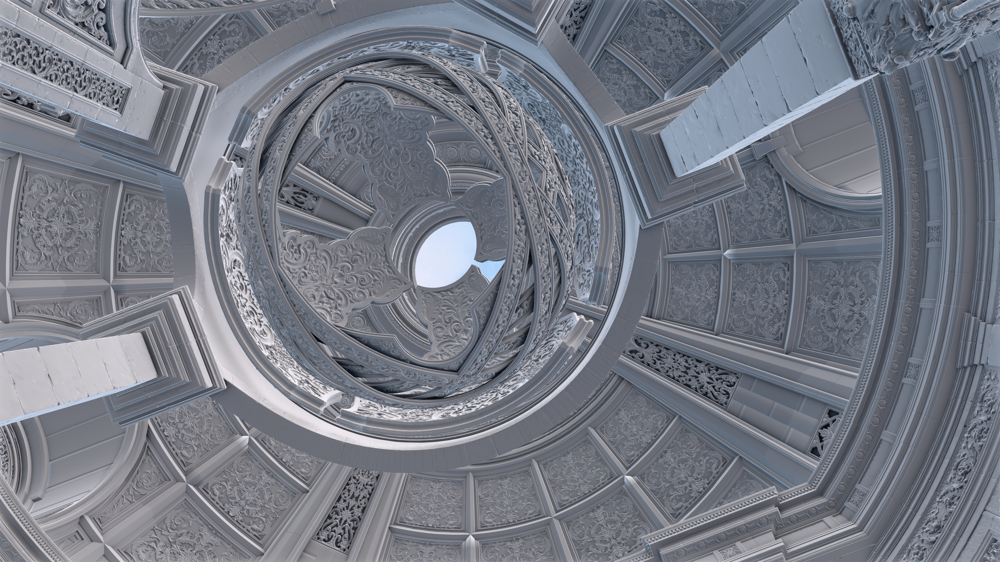
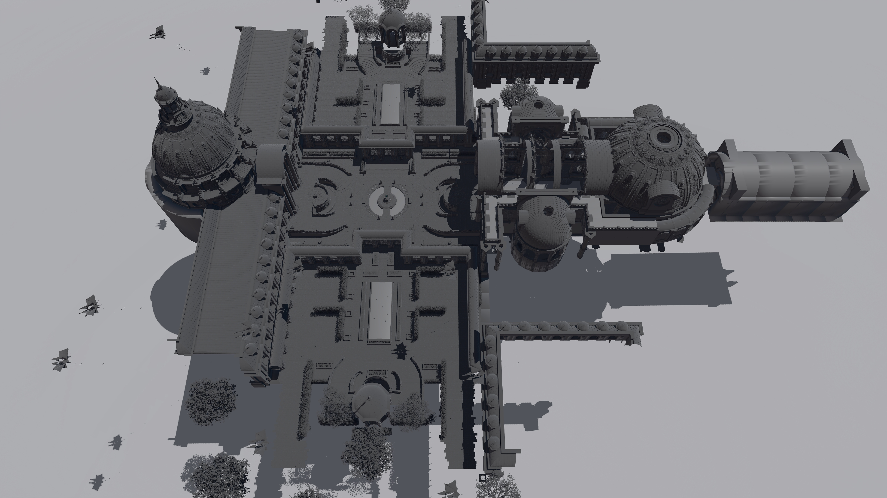

# Nyx — Virtualized Geometry & Virtual Shadow Maps

A personal DirectX 12 renderer exploring Nanite-style geometry, demand-driven streaming, and cached virtual shadow maps. Built on Microsoft MiniEngine.

**Mesh shaders · Continuous LOD · Geometry streaming · Virtual shadow maps**

[Watch Demo](https://www.youtube.com/watch?v=4YmfQTLy4jc) · [Zorah](#zorah-showcase) · [Bistro](#bistro-showcase) · [Gallery](#zorah-gallery) · [Build and Run](#build-and-run) · [Architecture](#architecture-overview)

[](https://www.youtube.com/watch?v=4YmfQTLy4jc)

**[▶ Watch the Zorah demo on YouTube](https://www.youtube.com/watch?v=4YmfQTLy4jc)** · [View the original 4K screenshot](Images/Zorah/Lit.jpg)

*Video recorded on AMD Ryzen 9 9950X · 96 GB RAM · NVIDIA GeForce RTX 5070.*

## Zorah Showcase

[NVIDIA's Zorah scene](https://developer.download.nvidia.com/ProGraphics/nvpro-samples/zorah_main_public.v2.gltf.7z) showcases virtualized geometry and virtual shadow maps at large scale, with hierarchical LOD selection, GPU-driven culling, demand-driven geometry streaming, and visualization modes for both geometry and shadows.

| Scene geometry | Triangle count |
| --- | ---: |
| Unique geometry | **1,627,207,159** |
| Including instances | **18,937,042,387** |

These are source-scene totals. The geometry rasterized each frame depends on visibility and LOD selection.

[](Images/Zorah/Zorah_Merge.jpg)

The comparison uses the same camera in all six modes. Click a mode below for its individual 4K screenshot.

| Top left | Top center | Top right |
| --- | --- | --- |
| [Lit](Images/Zorah/Lit.jpg) | [LOD](Images/Zorah/LOD.jpg) | [Meshlet](Images/Zorah/Meshlet.jpg) |
| **Bottom left** | **Bottom center** | **Bottom right** |
| [Triangle](Images/Zorah/Triangle.jpg) | [VSM Clipmap](Images/Zorah/VSMClip.jpg) | [VSM Page](Images/Zorah/VSMPage.jpg) |

[View the full-resolution comparison — 11520 × 4320](Images/Zorah/Zorah_Merge.jpg)

## Bistro Showcase

Bistro showcases the same virtualized geometry and virtual shadow map pipeline in a textured scene, highlighting shadow cache invalidation from animated objects.

[](Images/Bistro/main.jpg)

### Dynamic Shadow Cache Invalidation



Moving objects invalidate affected cached shadow pages, which are then updated. The animation shows the shadow cache responding as objects move through the scene.

<details>
<summary>More Bistro views</summary>

[](Images/Bistro/1.jpg)

</details>

## Zorah Gallery

<details>
<summary>Explore six additional lit views — click a screenshot for the 4K original</summary>

<table>
  <tr>
    <td><a href="Images/Zorah/1.jpg"></a></td>
    <td><a href="Images/Zorah/2.jpg"></a></td>
  </tr>
  <tr>
    <td><a href="Images/Zorah/3.jpg"></a></td>
    <td><a href="Images/Zorah/4.jpg"></a></td>
  </tr>
  <tr>
    <td><a href="Images/Zorah/5.jpg"></a></td>
    <td><a href="Images/Zorah/6.jpg"></a></td>
  </tr>
</table>

</details>

## Core Features

### Virtualized Geometry

- Nanite-style meshlet hierarchy with DAG/BVH traversal and screen-space LOD selection
- GPU-driven rendering via indirect `DispatchMesh`
- Two-pass frustum and HZB occlusion culling
- Visibility buffer rendering with deferred GBuffer resolve
- Demand-driven streaming with residency/address table updates, async page I/O, and LZ4-compressed geometry pages

### Virtual Shadow Maps

- Directional virtual shadow maps with clipmaps and GPU-driven page allocation
- Persistent shadow page caching with GPU LRU eviction and dynamic-object invalidation
- Multi-view shadow rendering with two-pass HZB occlusion culling and coarse-page fallback
- Directional SMRT soft shadows with adaptive receiver bias and short-range screen-space tracing
- Geometry-streaming-aware shadow cache refresh with budgeted page retries

Runtime Slang compilation provides shader reflection and root signature/binding generation. The tuning UI exposes pixel error, culling freeze, visualization modes, camera locking, and animation pause/resume.

## Build and Run

### Requirements

- Windows 10/11
- Visual Studio 2022 with the Desktop development with C++ workload
- DX12 GPU and driver supporting mesh shaders, Shader Model 6.6, and 64-bit integer atomics on typed textures
- NuGet package restore enabled
- Git and Git LFS

Slang and DXC are included under `MiniEngine/ThirdParty`; no separate shader compiler installation is required.

Recommended for large scenes:

- High-VRAM GPU
- 32 GB+ RAM (48 GB+ recommended for rebuilding very large assets)
- NVMe SSD
- Large free disk space

### Clone

Install Git LFS, then clone with the Bistro asset submodule (~1.55 GiB):

```powershell
git lfs install
git clone --recurse-submodules https://github.com/moonlovelj/Nyx.git
cd Nyx
```

For an existing checkout, run from the repository root:

```powershell
git submodule update --init --recursive
git -C MiniEngine/SceneViewer/Assets/bistro-metalrough lfs pull
```

### Build

1. Open `MiniEngine/SceneViewer/SceneViewer.sln`
2. Select `Release | Windows` (builds x64 binaries)
3. Build and run `SceneViewer`

The build automatically copies the Slang runtime, Slang standard module, `dxcompiler.dll`, and `dxil.dll` to the application output directory.

Without `-model`, SceneViewer loads `Assets/bunny/bunny.gltf` with **10,000 instances**.
With `-model`, the instance count defaults to **1**; use `-instances` to change it.

### Run the Showcase Scenes

From `MiniEngine\Build\x64\Release\Output\SceneViewer\`, load Bistro with:

```powershell
.\SceneViewer.exe -model .\Assets\bistro-metalrough\bistro_metalrough.gltf
```

Zorah is downloaded separately. Extract the [Zorah geometry export](https://developer.download.nvidia.com/ProGraphics/nvpro-samples/zorah_main_public.v2.gltf.7z) into `MiniEngine/SceneViewer/Assets/zorah_main_public.v2.gltf/`, then run:

```powershell
.\SceneViewer.exe -model .\Assets\zorah_main_public.v2.gltf\zorah_main_public.v2.gltf
```

### Shader Toolchain

Nyx uses the bundled **Slang** and **DXC** toolchain to compile Shader Model 6.6 DXIL at runtime. Slang reflection is used to generate root signatures and bind shader parameters by name.

Packaged builds load shaders and includes from their bundled `MiniEngine` tree. Local builds fall back to the repository source tree.

## Command Line

From the SceneViewer output directory, examples:

Typical path (default MiniEngine layout):

`MiniEngine\Build\x64\Release\Output\SceneViewer\`

```powershell
.\SceneViewer.exe -model .\Assets\bunny\bunny.gltf
.\SceneViewer.exe -model .\Assets\Jinx\scene.gltf -instances 3600
.\SceneViewer.exe -model .\Assets\bistro-metalrough\bistro_metalrough.gltf
.\SceneViewer.exe -model .\Assets\bunny\bunny.gltf -rebuild 1
```

Arguments:

- `-model <path>`: glTF/glb scene path
- `-instances <N>`: instance count when used with `-model` (default **1**, clamped to `1..1000000`)
- `-rebuild 1`: force rebuild `.mini` cache

## Controls

- `W A S D` / `Q E`: move
- Mouse: look
- Mouse wheel: movement speed scale
- `Shift`: fine movement toggle
- `Backspace`: engine tuning/debug UI
- Hold `Alt`: interact with the UI
- `Camera/Lock Camera`: freeze the current camera for screenshots; uncheck to resume camera control
- `Application/Pause Animations`: pause all model animations at the current time; uncheck to resume playback

Rendering and display resolutions default to **Monitor Native**, using the window's monitor desktop resolution in physical pixels, with a borderless fullscreen window. Windows DPI scaling does not reduce the rendering resolution. Under `Graphics/Display`, change `Native Resolution` to adjust internal rendering, or select a preset for `Display Resolution` to return to a regular window.

Source LDR material textures default to BC7 DDS with full mip chains when both dimensions are multiples of four; other LDR dimensions use uncompressed RGBA8. Color maps use sRGB formats, and data maps use linear formats. Existing `.mini` geometry caches automatically adopt this policy. Stale DDS files and caches with incompatible formats are rebuilt from the source image on load; the first conversion can take longer. BC6H/BC7 encoding uses GPU acceleration when available, with a CPU fallback. Authored DDS inputs are preserved, and DDS-only packages remain loadable.

## Architecture Overview

### Virtualized Geometry

Meshes are split into meshlets, then grouped and simplified to build the
LOD hierarchy. The GPU selects LODs using a screen-space error threshold
and performs frustum and HZB culling in two passes. Geometry pages are
compressed with LZ4 and loaded as needed. Root pages are pinned within the
residency budget (up to 6,144 pages, subject to available slots), providing
a coarse LOD while finer geometry is loading.

<details>
<summary>Offline build and runtime frame flow</summary>

### Offline / First-load Build (`.gltf/.glb` -> `.mini`)

1. Parse scene/material/camera/animation data
2. Build meshlets and meshlet groups
3. Iteratively simplify groups for multi-level LOD
4. Build hierarchy nodes and metadata
5. Pack geometry pages
6. Compress pages with LZ4
7. Save metadata + blob to `.mini`

### Runtime Frame Flow

1. Instance and DAG/hierarchy culling
2. Two-pass visibility rendering with depth export and HZB generation
3. Mark VSM page requests from visible receivers
4. Reuse cached shadow pages and allocate physical pages for new requests
5. Build multi-view shadow rendering data
6. Resolve the visibility buffer to GBuffer
7. Render directional VSM depth with two-pass HZB culling
8. Deferred lighting with VSM shadow sampling, followed by post effects

</details>

### Directional Virtual Shadow Maps

The sun uses clipmaps centered on the camera. Visible pixels determine
which shadow pages are needed. Pages are cached across frames in a shared
physical pool, with GPU LRU eviction to reclaim space. Object movement
marks affected pages for redraw. Shadow updates use multi-view rendering
and two-pass HZB culling, with SMRT sampling for soft shadows.

### Streaming Runtime

- Page size: **256 KB**
- Chunk size: **256 MB**
- GPU request mask readback + async page load + LZ4 decompress + upload

### Shadow Updates During Streaming

If a shadow page is rendered before its target geometry LOD has loaded,
it is marked incomplete. Its cached depth can still be sampled. After new
geometry is uploaded, incomplete pages are retried under a per-frame
budget, so shadow detail catches up as geometry loads.

The retry budget and pending/retried page counts are available under
`Renderer/VSM` in the runtime tuning UI.

## Technical Snapshot

- Language: **C++20**
- Graphics API: **DirectX 12**
- Shader language/compiler frontend: **Slang 2026.10**
- DXIL compiler backend: **DXC 2026-05-27**
- Shader Model: **6.6**
- Agility SDK package: `Microsoft.Direct3D.D3D12 1.616.1`
- Meshlet defaults: max vertices **64**, max triangles **84**, group size **32**, BVH node children **8**

## Repository Layout

- `MiniEngine/Core`: engine core and rendering systems
- `MiniEngine/Model`: model conversion, meshlets, culling, streaming, shaders
- `MiniEngine/SceneViewer`: runtime app
- `MiniEngine/SceneViewer/Assets`: sample and stress scenes

## Notes

- To load custom glTF assets, place them under `MiniEngine/SceneViewer/Assets` and pass the path with `-model`.
- This project uses MiniEngine conventions (right-handed coordinate handling inside the renderer path).
- Large-scene build time depends heavily on CPU, storage bandwidth, and available memory.

## Acknowledgements

- Zorah geometry export: NVIDIA
- [Bistro Metallic-Roughness](https://github.com/moonlovelj/bistro-metalrough), based on Amazon Lumberyard Bistro
- [Unreal Engine Nanite talks and publications](https://advances.realtimerendering.com/s2021/Karis_Nanite_SIGGRAPH_Advances_2021_final.pdf)
- [Microsoft MiniEngine](https://github.com/microsoft/DirectX-Graphics-Samples/tree/master/MiniEngine)
- [DirectXTex](https://github.com/microsoft/DirectXTex), [DirectXMesh](https://github.com/microsoft/DirectXMesh), and [DirectXMath](https://github.com/microsoft/DirectXMath)
- [meshoptimizer](https://github.com/zeux/meshoptimizer)
- [lz4](https://github.com/lz4/lz4)
- [cgltf](https://github.com/jkuhlmann/cgltf)
- [imgui](https://github.com/ocornut/imgui)
- [Slang](https://github.com/shader-slang/slang)
- [DirectX Shader Compiler](https://github.com/microsoft/DirectXShaderCompiler)
- [D3D12 Agility SDK](https://www.nuget.org/packages/Microsoft.Direct3D.D3D12/1.616.1) and [PIX Event Runtime](https://devblogs.microsoft.com/pix/winpixeventruntime/)
- [Intel XeGTAO](https://github.com/GameTechDev/XeGTAO) and [Intel TAA](https://github.com/GameTechDev/TAA)
- Inspiration references: [nanite-webgpu](https://github.com/Scthe/nanite-webgpu), [vk_lod_clusters](https://github.com/nvpro-samples/vk_lod_clusters)

## License

- Nyx source code: MIT License ([LICENSE](LICENSE))
- Third-party components: original licenses ([THIRD_PARTY_NOTICES.md](THIRD_PARTY_NOTICES.md))
- Scene assets may have separate licenses and restrictions; verify before redistribution
