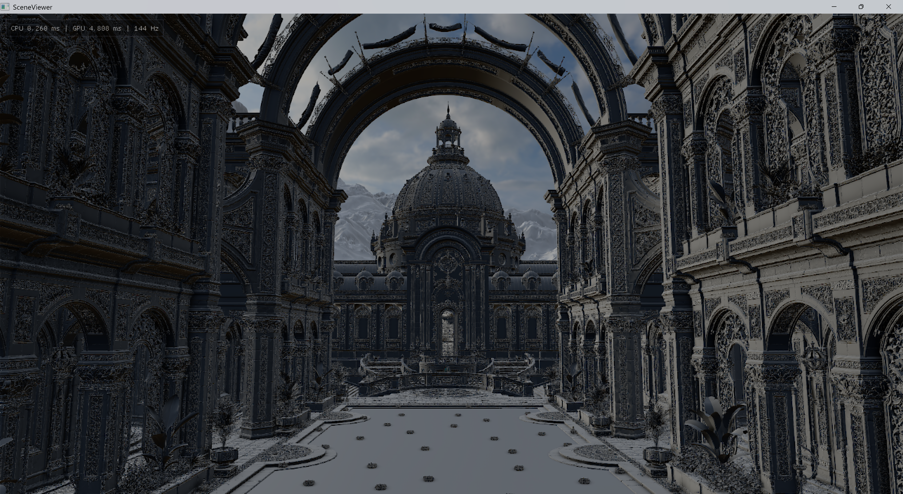
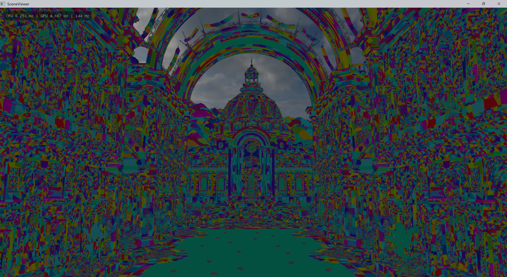
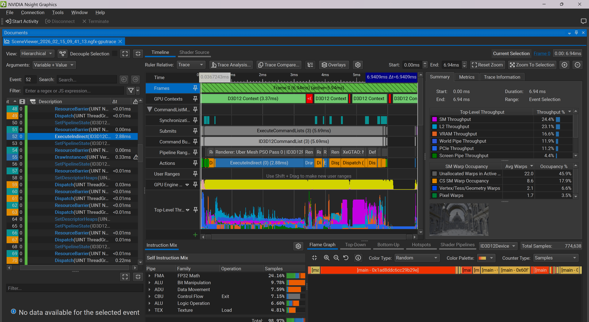

# Nanite-style virtualized geometry renderer on DirectX 12

Nanite-style virtualized geometry renderer on DirectX 12 (built on Microsoft MiniEngine).

Nyx is a personal research project focused on extreme-scale geometry rendering: continuous LOD, GPU-driven culling, mesh-shader dispatch, and demand-driven geometry streaming.

The current stress test scene is [Zorah](https://developer.download.nvidia.com/ProGraphics/nvpro-samples/zorah_main_public.v2.gltf.7z) (NVIDIA), with:

- **1,639,668,228 unique triangles**
- **18,949,504,889 instanced triangles**

## Showcase

Test platform for the screenshots/video below: **i7-14700KF + RTX 4070 Ti SUPER**, rendered at **4K**.

Demo video:

<h2 align="center">🎬 Nyx – Nanite-Style Virtualized Geometry Renderer</h2>

<p align="center">
  <a href="https://www.youtube.com/watch?v=mBEIvRWloCw">
    
  </a>
</p>


<p align="center">
  4K • 144Hz • 18.9B Instanced Triangles • RTX 4070 Ti SUPER
</p>


Screenshots:

<p align="center">Lit mode</p>




<p align="center">Meshlet mode</p>




<p align="center">Triangle mode</p>




## Core Features

- Nanite-style meshlet hierarchy with DAG/BVH traversal
- GPU-driven rendering via indirect `DispatchMesh`
- Two-pass frustum + HZB occlusion culling
- Visibility buffer pipeline, then resolve to deferred GBuffer
- Dynamic geometry streaming with residency/address table updates
- Async page IO + LZ4-compressed geometry pages
- Runtime Slang shader compilation and reflection-driven root signatures/bindings
- Runtime debug/tuning UI (pixel error, culling freeze, debug modes)
- Directional virtual shadow maps with clipmaps and GPU-driven page allocation
- Persistent shadow page caching with GPU LRU eviction and dynamic-object invalidation
- Multi-view shadow rendering with two-pass HZB occlusion culling and coarse-page fallback
- Directional SMRT soft shadows with adaptive receiver bias and short-range screen-space tracing
- Geometry-streaming-aware shadow cache refresh with budgeted page retries

## Quick Start

### Requirements

- Windows 10/11
- Visual Studio 2022 with the Desktop development with C++ workload
- DX12 GPU with Mesh Shader support
- NuGet package restore enabled
- Git and Git LFS

Slang and DXC are included under `MiniEngine/ThirdParty`; no separate shader compiler installation is required.

Recommended for large scenes:

- High-VRAM GPU
- 32 GB+ RAM (48 GB+ recommended for rebuilding very large assets)
- NVMe SSD
- Large free disk space

### Clone

Install Git LFS, then clone with the Bistro asset submodule (~1.55 GiB):

```powershell
git lfs install
git clone --recurse-submodules https://github.com/moonlovelj/Nyx.git
cd Nyx
```

For an existing checkout, run from the repository root:

```powershell
git submodule update --init --recursive
git -C MiniEngine/SceneViewer/Assets/bistro-metalrough lfs pull
```

### Build

1. Open `MiniEngine/SceneViewer/SceneViewer.sln`
2. Select `Release | Windows` (builds x64 binaries)
3. Build and run `SceneViewer`

The build automatically copies the Slang runtime, Slang standard module, `dxcompiler.dll`, and `dxil.dll` to the application output directory.

Without `-model`, SceneViewer loads `Assets/bunny/bunny.gltf` with **10,000 instances**.
With `-model`, the instance count defaults to **1**; use `-instances` to change it.

### Shader Toolchain

Nyx uses the bundled **Slang** and **DXC** toolchain to compile Shader Model 6.6 DXIL at runtime. Slang reflection is used to generate root signatures and bind shader parameters by name.

Packaged builds load shaders and includes from their bundled `MiniEngine` tree. Local builds fall back to the repository source tree.

### Zorah Quick Start (Prebuilt Cache)

Building Zorah cache locally can be time-consuming and memory-intensive.
If you only want to run the demo, use the prebuilt files:

- [Download prebuilt Zorah package](https://pan.quark.cn/s/28de91939fee)

After download, extract/copy the files to:

`MiniEngine/SceneViewer/Assets/zorah_main_public/`

Then run:

```powershell
.\SceneViewer.exe -model .\Assets\zorah_main_public\zorah_main_public.gltf
```

## Command Line

From the SceneViewer output directory, examples:

Typical path (default MiniEngine layout):

`MiniEngine\Build\x64\Release\Output\SceneViewer\`

```powershell
.\SceneViewer.exe -model .\Assets\bunny\bunny.gltf
.\SceneViewer.exe -model .\Assets\Jinx\scene.gltf -instances 3600
.\SceneViewer.exe -model .\Assets\bistro-metalrough\bistro_metalrough.gltf
.\SceneViewer.exe -model .\Assets\bunny\bunny.gltf -rebuild 1
```

Arguments:

- `-model <path>`: glTF/glb scene path
- `-instances <N>`: instance count when used with `-model` (default **1**, clamped to `1..1000000`)
- `-rebuild 1`: force rebuild `.mini` cache

## Controls

- `W A S D` / `Q E`: move
- Mouse: look
- Mouse wheel: movement speed scale
- `Shift`: fine movement toggle
- `Backspace`: engine tuning/debug UI
- Hold `Alt`: interact with the UI

Rendering and display resolutions default to **Monitor Native**, using the window's monitor desktop resolution in physical pixels, with a borderless fullscreen window. Windows DPI scaling does not reduce the rendering resolution. Under `Graphics/Display`, change `Native Resolution` to adjust internal rendering, or select a preset for `Display Resolution` to return to a regular window.

Source material textures compile to BC7 DDS with full mip chains, using sRGB for color maps and linear formats for data maps. Existing `.mini` geometry caches automatically adopt this policy. Stale DDS files and caches with incompatible formats are rebuilt from the source image on load; the first conversion can take longer. BC6H/BC7 encoding uses GPU acceleration when available, with a CPU fallback. Authored DDS inputs are preserved, and DDS-only packages remain loadable.

## Architecture Overview

### Virtualized Geometry

Meshes are split into meshlets, then grouped and simplified to build the
LOD hierarchy. The GPU selects LODs using a screen-space error threshold
and performs frustum and HZB culling in two passes. Geometry pages are
compressed with LZ4 and loaded as needed. Root pages stay resident,
providing a coarse LOD while finer geometry is loading.

### Offline / First-load Build (`.gltf/.glb` -> `.mini`)

1. Parse scene/material/camera/animation data
2. Build meshlets and meshlet groups
3. Iteratively simplify groups for multi-level LOD
4. Build hierarchy nodes and metadata
5. Pack geometry pages
6. Compress pages with LZ4
7. Save metadata + blob to `.mini`

### Runtime Frame Flow

1. Instance and DAG/hierarchy culling
2. Two-pass visibility rendering with depth export and HZB generation
3. Mark VSM page requests from visible receivers
4. Reuse cached shadow pages and allocate physical pages for new requests
5. Build multi-view shadow rendering data
6. Resolve the visibility buffer to GBuffer
7. Render directional VSM depth with two-pass HZB culling
8. Deferred lighting with VSM shadow sampling, followed by post effects

### Directional Virtual Shadow Maps

The sun uses clipmaps centered on the camera. Visible pixels determine
which shadow pages are needed. Pages are cached across frames in a shared
physical pool, with GPU LRU eviction to reclaim space. Object movement
marks affected pages for redraw. Shadow updates use multi-view rendering
and two-pass HZB culling, with SMRT sampling for soft shadows.

### Streaming Runtime

- Page size: **256 KB**
- Chunk size: **256 MB**
- GPU request mask readback + async page load + LZ4 decompress + upload

### Shadow Updates During Streaming

If a shadow page is rendered before its target geometry LOD has loaded,
it is marked incomplete. Its cached depth can still be sampled. After new
geometry is uploaded, incomplete pages are retried under a per-frame
budget, so shadow detail catches up as geometry loads.

The retry budget and pending/retried page counts are available under
`Renderer/VSM` in the runtime tuning UI.

## Technical Snapshot

- Language: **C++20**
- Graphics API: **DirectX 12**
- Shader language/compiler frontend: **Slang 2026.10**
- DXIL compiler backend: **DXC 2026-05-27**
- Shader Model: **6.6**
- Agility SDK package: `Microsoft.Direct3D.D3D12 1.616.1`
- Meshlet defaults: max vertices **64**, max triangles **84**, group size **32**, BVH node children **8**

## Repository Layout

- `MiniEngine/Core`: engine core and rendering systems
- `MiniEngine/Model`: model conversion, meshlets, culling, streaming, shaders
- `MiniEngine/SceneViewer`: runtime app
- `MiniEngine/SceneViewer/Assets`: sample and stress scenes

## Notes

- To load custom glTF assets, place them under `MiniEngine/SceneViewer/Assets` and pass the path with `-model`.
- This project uses MiniEngine conventions (right-handed coordinate handling inside the renderer path).
- Large-scene build time depends heavily on CPU, storage bandwidth, and available memory.

## Acknowledgements

- [Unreal Engine Nanite talks and publications](https://advances.realtimerendering.com/s2021/Karis_Nanite_SIGGRAPH_Advances_2021_final.pdf)
- [Microsoft MiniEngine](https://github.com/microsoft/DirectX-Graphics-Samples/tree/master/MiniEngine)
- [DirectXTex](https://github.com/microsoft/DirectXTex), [DirectXMesh](https://github.com/microsoft/DirectXMesh), and [DirectXMath](https://github.com/microsoft/DirectXMath)
- [meshoptimizer](https://github.com/zeux/meshoptimizer)
- [lz4](https://github.com/lz4/lz4)
- [cgltf](https://github.com/jkuhlmann/cgltf)
- [imgui](https://github.com/ocornut/imgui)
- [Slang](https://github.com/shader-slang/slang)
- [DirectX Shader Compiler](https://github.com/microsoft/DirectXShaderCompiler)
- [D3D12 Agility SDK](https://www.nuget.org/packages/Microsoft.Direct3D.D3D12/1.616.1) and [PIX Event Runtime](https://devblogs.microsoft.com/pix/winpixeventruntime/)
- [Intel XeGTAO](https://github.com/GameTechDev/XeGTAO) and [Intel TAA](https://github.com/GameTechDev/TAA)
- Inspiration references: [nanite-webgpu](https://github.com/Scthe/nanite-webgpu), [vk_lod_clusters](https://github.com/nvpro-samples/vk_lod_clusters)

## License

- Nyx source code: MIT License ([LICENSE](LICENSE))
- Third-party components: original licenses ([THIRD_PARTY_NOTICES.md](THIRD_PARTY_NOTICES.md))
- Scene assets may have separate licenses and restrictions; verify before redistribution
